<!-- ========================================================= -->
<!--                          HERO                             -->
<!-- ========================================================= -->

  <a href="https://foliotresor.netlify.app">
    
  </a>


<!-- ========================================================= -->
<!--                        INTRO                              -->
<!-- ========================================================= -->

<table align="center" width="96%">
<tr>
<td valign="top">

<h2>From data to decisions</h2>

I'm a <strong>Junior AI &amp; Data Engineer from Lomé, Togo</strong> who turns
ideas into reliable pipelines, practical ML models, and well-governed data systems.

From <strong>football prediction platforms with ML</strong> to <strong>AI-assisted security audits</strong>,
I care about clean code, honest metrics, and shipping tools teams actually use.

<table>
<tr>
<td><strong>Data</strong> Python · SQL · ETL · Pandas</td>
<td><strong>ML &amp; IA</strong> TensorFlow · scikit-learn · LLMs · RAG</td>
</tr>
<tr>
<td><strong>Cloud</strong> Azure · Docker · GitHub Actions · Go</td>
<td><strong>DBA</strong> MongoDB · PostgreSQL · MySQL · modélisation</td>
</tr>
</table>

<a href="https://mvp.microsoft.com/en-US/studentambassadors/profile/00c65939-0b47-4bdc-9702-4f9511451b47"><strong>Microsoft Student Ambassador</strong></a> · DBA &amp; data engineering 
Portfolio at <a href="https://foliotresor.netlify.app">foliotresor.netlify.app</a> · open source on <a href="https://github.com/TresorAlad">GitHub</a> 
<em>Fun fact: I can debug a Jupyter notebook faster than a Friday-night SQL script.</em>

</td>
</tr>
</table>

  

 

 


<!-- ========================================================= -->
<!--                   TECHNOLOGY MATRIX                       -->
<!-- ========================================================= -->

  


<!-- ========================================================= -->
<!--                      WHAT I BUILD                         -->
<!-- ========================================================= -->

  


<!-- ========================================================= -->
<!--                     FEATURED WORK                         -->
<!-- ========================================================= -->

<h2 align="center">Featured Work</h2>

<table align="center" width="96%">
<tr>
<td width="50%" valign="top">
<h3><a href="https://github.com/TresorAlad/Pronostic-AI">Pronostic-AI</a></h3>
Go · ML · agent IA

Football prediction platform with ML models, explainable AI agent, and live market tracking.

</td>
<td width="50%" valign="top">
<h3><a href="https://github.com/TresorAlad/DeDeFIA">DeDeFIA</a></h3>
Python · sécurité · IA

Automated web security audits: vulnerability detection, security score, and AI recommendations.

</td>
</tr>
<tr>
<td width="50%" valign="top">
<h3><a href="https://github.com/TresorAlad/GitInsight">GitInsight</a></h3>
Go · CLI

Open-source Go CLI to analyze commits, contributors, and branches in Git repositories.

</td>
<td width="50%" valign="top">
<h3><a href="https://github.com/TresorAlad/Software-Factory-MCP">Software-Factory-MCP</a></h3>
Python · MCP · agents

Turn Cursor into a local software factory with MCP agents for architecture, QA, and security.

</td>
</tr>
</table>

<a href="https://foliotresor.netlify.app"><b>Explore all projects →</b></a>


<!-- ========================================================= -->
<!--                      OBSERVABILITY                        -->
<!-- ========================================================= -->

<h2 align="center">Activity</h2>

  
  

  

  


<!-- ========================================================= -->
<!--                        DEV PETS                           -->
<!-- ========================================================= -->

  


<!-- ========================================================= -->
<!--                        CONNECT                            -->
<!-- ========================================================= -->

  

  
  
  
  

